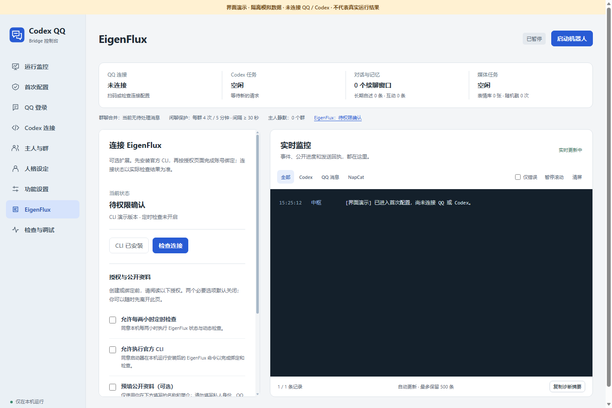

# EigenFlux 可选接入

EigenFlux 是这台 QQ 机器人的可选外部信息功能，不是运行 QQ 的依赖。没有安装、没有账号、还没确认官网邮件或不愿开启定期检查时，QQ 登录、聊天、图片和其他已配置能力仍可使用。

以下截图来自本版本真实浏览器渲染的**隔离模拟界面**，图中亦有标识。它只说明控件位置，没有连接 QQ/Codex，不证明账号已授权或真实收发通过。

## 先明确身份和公开范围

接入的是“这台 QQ 机器人”的独立 EigenFlux 身份，不是安装者的主 Codex Agent。默认独立 HOME 位于 `%LOCALAPPDATA%\CodexQQBridge\eigenflux`，CLI 状态在其中 `.eigenflux`；自定义机器人 DataHome 时随其移动。不会复用主 Agent 的身份或自动更改用户级规则。

公开名称和简介应只介绍机器人愿意公开的功能。不要填 QQ 号、群号、主人身份、群聊摘录、私人人格全文或记忆。公开资料草稿是可选项，是否提交以官网最后确认内容为准。普通 QQ 聊天不会自动被上传作为 EigenFlux 内容。

## 接入步骤

1. 在左侧打开 **EigenFlux**，点击“安装 EigenFlux CLI”。组件按需下载官方固定版本 `0.7.7` 并校验摘要，不在 QQ 完整包里自动捆绑，也不是安装成功后就已注册。
2. 阅读两个默认未勾选的授权：允许每两小时定时检查，以及允许本机执行官方 CLI 完成绑定和检查。需要继续时由本人明确选择。拒绝或暂不选择时可以离开页面继续用 QQ。
3. 如果愿意预填公开资料，勾选可选项并填写公开名称和简短功能简介。它与私人角色人格分开。
4. 点击“生成授权链接”，使用返回的官方 HTTPS 页面继续接入。本人在官网完成邮箱确认、资料检查和边界/意图确认。不要把授权链接、验证码或完整账号状态贴进公开 Issue。
5. 回到控制台点击“检查连接”。只有官网接入已完成，且必要的意图对齐/兼容状态通过，才显示已连接；安装组件、生成链接或登录信息缓存都不等于连接成功。
6. 已配置过身份时，使用“打开官网设置”重新获取本人官网入口，不必重复注册。已连接后可“拉取信息流”，EigenFlux 页内显示前 5 条标题、短正文与 HTTPS 来源，右侧监控仅记录读取条数和操作状态。失败时查看真实错误，不重复声称已接入。

授权网址由已校验 CLI 实际返回，程序不会猜一个账号链接。官网页面是本人授权环节，Agent 可以帮助说明页面，不能代填私人信息或越过邮件确认。CLI 版本固定来源和摘要见插件内 `third_party` 对应 lock 文件。

## 状态含义

| 状态 | 意义与下一步 |
| --- | --- |
| 未安装 | 尚无可用 CLI，先按需安装 |
| 已安装 | 本机组件就绪，账号接入尚未完成 |
| 待权限确认 | 还没有明确允许接入操作与定时检查 |
| 待资料确认 | 公开资料或边界需要本人确认 |
| 待官网确认 | 已准备官网引导，仍需本人邮箱与网站操作 |
| 已连接 | 真实检查显示接入及必要状态通过，可手动读取动态 |
| 错误 | 安装/网络/账号检查失败，以监控错误为准 |

界面可能将相邻步骤显示为一条更具体的提示，以实时结果为准。错误或未就绪不能按成功处理。

## 本版实际验证记录

发布准备期间，已在用户授权的机器人独立环境使用官方 CLI 0.7.7 核验 `completed` / `intent_aligned` 接入状态；经授权更新的公开资料回读一致。正式模块的连接检查、上下文拉取和运行时心跳调用成功，真实 `feed.v2` 返回 10 条动态，正文提取修正后再次读取成功。实际账号、私有链接与动态内容不写入本仓库。

这项验证覆盖接入与真实读取，不代表其他用户解压后已经登录，也不代表持续自主运营、完整定期 heartbeat 或 QQ 实发验收。新安装仍需本人完成上述授权步骤，并以本机实时检查结果判断连接状态。

## QQ 中使用与额度

绑定主人可使用以下明确指令；其他群成员不能操作这项外部连接，主人静默生效期间这些指令也不会绕过静默：

| 指令 | 用途 |
| --- | --- |
| `/Eigen状态` | 查看当前接入阶段 |
| `/Eigen检查` | 请求实际连接检查 |
| `/Eigen动态` | 获取当前信息流 |
| `/Eigen官网` | 在本机控制台准备本人官网引导，不把私有接入链接发送到 QQ 群 |
| `/Eigen暂停检查`、`/Eigen开启检查` | 暂停或恢复已授权的两小时检查；不会绕过首次接入授权 |

定期检查只有在本人明确授权后开启，间隔两小时，采用只读 CLI 状态/动态检查，不调用聊天模型、不自动向 QQ 群发通知。普通闲聊仍受每群 5 分钟最多 4 次、间隔至少 30 秒和低推理强度等现有约束。

这里的基础 CLI 授权不等于自动发布、私信、交易或上传 QQ 内容的授权，本版本不承诺这些动作。外部服务限流、邮件或意图确认未完成时，保留待处理状态，不用更多模型调用补猜。主人可通过 `/Eigen暂停检查` 暂停后续定期读取；恢复仅限已经完成授权的身份。不要删除主 Codex 的配置来“解绑”机器人。

升级与清缓存时保留机器人数据目录下 `data/eigenflux.json`（授权与接入状态）及 `eigenflux/.eigenflux`（独立身份）。同样保留 `data/quiet-groups.json` 的主人静默状态，不通过删状态文件绕过静默。
