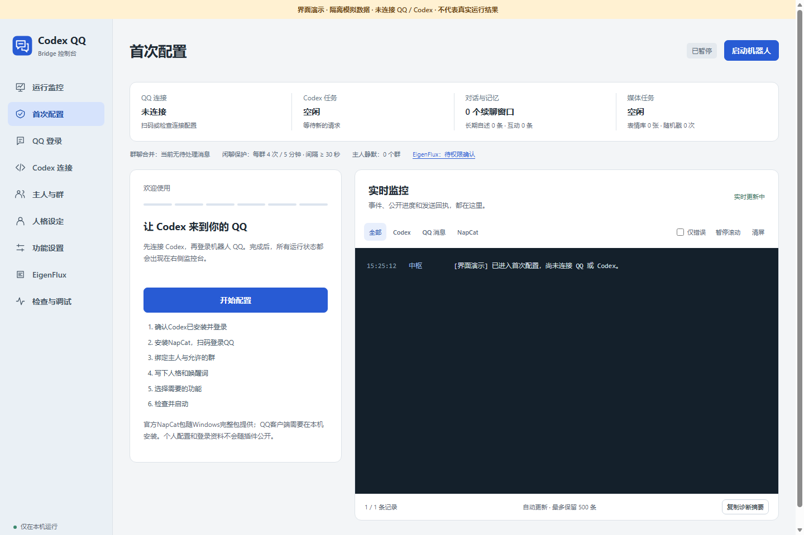
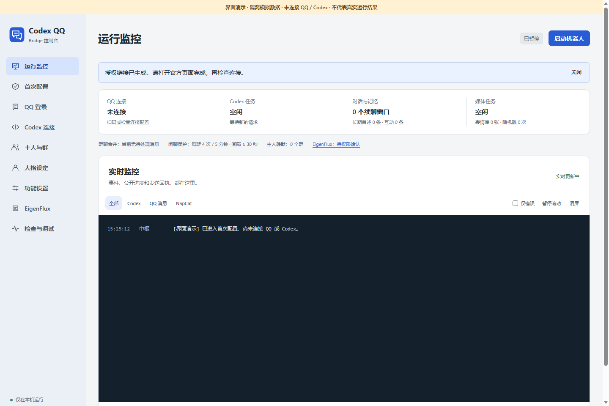

# 使用说明

首次可双击 `scripts\bootstrap.cmd` 自动探测 Codex 和 QQ 路径，打开回复暂停的控制台；也可双击 `启动机器人.cmd`。完整 Windows 包已包含固定版本便携 Node/NapCat；源码版会按 lock 文件地址下载并校验。官方 QQ 客户端与 Codex 账号需自行准备。不需要 `npm install` 或在机器人里填写 API Key。

以下两张截图是真实浏览器渲染的**隔离模拟界面**，图中带有演示标识，仅用于定位按钮，不代表已连接 QQ/Codex 或通过真实账号收发验收。

第一次自动显示配置引导，右侧是实时监控终端。左侧可随时切换 QQ 登录、Codex 连接、绑定、人格和功能设置；未完成的步骤可以稍后继续。

1. **Codex连接**：填写或自动使用本机CLI。点击检测登录；未授权时点登录，右侧显示官方设备授权地址与代码。完成后重新检测。测试回复只调用模型，不发QQ。
2. **QQ登录**：填写官方QQ.exe完整路径、保存、安装并启动NapCat。获取二维码，用机器人账号手机QQ扫码。在登录完成后点击“完成连接配置”，等待接口重载，检查状态直到QQ与OneBot同时就绪。遇到验证码或新设备验证，用嵌入的原生高级界面处理；界面提供复制本机WebUI密钥，不需要翻日志找token。
3. **绑定**：填写自己的个人QQ号作为主人，选择允许的群。默认主人和群均为空，不自动开放任何群。可读取该机器人已加入的群；读取列表不等于已允许所有群。机器人自己的 QQ 号不是主人号。群主与管理员在真实操作时查询，不相信昵称或聊天自称。
4. **人格**：填写名称、逗号分隔的唤醒词和人格。可选白龙娘或通用助手预设，保存后预览。预览不会发QQ消息。
5. **功能**：基础上下文、续聊、长期记忆和视觉默认开启；其余行为由你选择。点歌先安装音源组件。生图需要当前Codex账号提供相应原生工具。
6. **检查与启动**：检查通过后完成配置。启动后仅处理允许范围中的新消息；不会重放历史发消息。

首次真实验收由本人在已允许的群中实际 @ 机器人，核对手机里收到的内容与监控中的消息回执。Codex 测试回复、模拟测试、接口可达和账号信息缓存不等于真实 QQ 收发通过。扫码、验证码、新设备确认和 Codex 官方授权必须本人完成。

EigenFlux 不属于必需步骤。想使用时再进入独立页面，安装组件、明确操作与两小时检查授权、本人完成官网邮箱/资料/边界确认。未配置不影响 QQ。详见 [EigenFlux 指南](eigenflux.md)。

## 日常操作

- 主页面是运行监控。查看QQ在线状态、当前Codex任务、续聊窗口、媒体任务和右侧终端。
- 终端支持来源筛选、仅错误、暂停滚动、清屏；清屏只清当前页面显示。
- 复制诊断摘要不含账号、群号、人格、聊天或密钥。请仍在分享前自己查看内容。
- 暂停机器人保留QQ登录；停止NapCat只结束此安装管理的进程。关闭窗口不会关服务。
- 需要退出或升级程序时，暂停后双击`停止控制台.cmd`；它通过已认证本机接口关闭控制台并保留QQ登录，不按猜测的PID杀进程。
- 修改配置前先暂停并等待当前队列结束。所有设置保存在本地数据目录，刷新后仍在。

## 聊天与续聊

@、唤醒词或引用机器人明确唤醒。确认发出回复后，同群同人两分钟内最多自动跟进2次，自动回复间隔至少30秒，成功回复不会无限续期。其他成员及主动插话不会继承或开启续聊。简短附和、括号动作、结束语优先跳过。谈论被@者时保留真实QQ和昵称；转去与别人说话时不代答。`/结束对话`或“不用回复了”结束个人窗口。

普通群消息先等待停顿：低频约2秒；10秒内达到4条则等待连续6秒安静。期间新消息继续合并，读取这段最新上下文后至多生成一条回答，并引用对应请求。冷却期间继续合并，不逐条调用模型。普通群闲聊模型调用至少间隔30秒，同群5分钟最多4次；失败或模型选择静默也记入已发生的调用。点歌、生图等明确工具请求单独处理。

主人说“把尾巴收一收”或“龙娘，别理他”，立即取消本群等待话题、停止当前生成并进入持久静默。不给群发送确认消息，不调用模型。静默期间普通消息、其他人的@、戳一戳均忽略；只有已绑定主人通过QQ实际@机器人才能恢复。普通喊名字、引用机器人或@全体成员不能恢复；重启保持静默。

普通群聊的自动插话单独控制，至少五分钟成功发送冷却，并有概率和气氛判断。开启后也不保证每隔五分钟发言。无人发言时不会定时找人。

公开默认配置关闭主动插话和自动收藏表情，推理强度为低；功能需本人选择。升级时保留用户已有开关，不用默认值覆盖。已有表情库在相关功能开启后可继续使用。

## 常用指令

| 指令 | 说明 |
| --- | --- |
| `/点歌 歌名 歌手` | B站公开音源，直接输出QQ语音，最长10分钟 |
| `/点歌状态` | 查看当前会话最近一次点歌结果 |
| `/生图 一条白龙，水彩风格` | 主人发起图片任务；原生工具不可用时明确失败 |
| `/图片状态` | 最近生图任务状态 |
| `/群管帮助`、`/群管状态` | 查看命令与机器人真实群角色 |
| `/禁言 QQ号 10分钟`、`/解禁 QQ号` | 仅主人，机器人和主人都需真实管理身份 |
| `/群文件`、`/整理群文件` | 列表或整理预览，不删除群文件；确认码后再执行 |
| `/戳我`、`/戳回开`、`/戳回关` | 戳一戳及自动戳回设置 |
| `/随机戳 状态`、`/随机戳 开`、`/随机戳 关` | 还需启动器总功能开启 |
| `/别戳我`、`/可以戳我` | 普通成员退出或恢复随机戳候选 |
| `/表情包 状态`、`/表情包 列表`、`/表情包 发 编号` | 使用本群表情库 |
| `/偷表情包` | 主人引用或附带图片，手动理解并收藏 |
| `/记忆 查看`、`/记忆 记住 我喜欢…` | 主人的记忆管理入口 |
| `/记忆 忘记 关键词`、`/记忆 清空本会话 确认` | 忘记记忆，固定绑定身份不变 |
| `/Eigen状态`、`/Eigen检查` | 仅主人查看或检查可选 EigenFlux 连接；未接入时给出真实状态 |
| `/Eigen动态`、`/Eigen官网` | 仅主人读取动态或在本机准备官网确认入口；不把私有链接发到群，静默时不绕过静默 |

群管指令需明确@机器人或使用斜杠，续聊不会伪造@权限。文字语气由人格决定，功能提示可能使用简短固定句。

## 数据保留

`%LOCALAPPDATA%\CodexQQBridge`中：`config.json`含密钥和绑定；`vendor/NapCat`含QQ本地登录与配置；`data/companion.json`是长期记忆；`data/stickers`是表情库；`runtime/generated-images`是已生成作品。升级保留这些。音频和识图临时目录由任务清理；不要为了清缓存删整个数据目录。

自定义目录可在启动前设置 `CODEX_QQ_HOME`；bootstrap 也接受 `-DataHome`，以后启动保持相同目录。`data/quiet-groups.json` 是主人静默状态，`data/eigenflux.json` 是 EigenFlux 授权与接入状态；可选 EigenFlux 另有独立身份 `eigenflux/.eigenflux`，不复用主 Codex Agent。升级与清缓存均保留这些文件和目录，不把它们当临时缓存删除。私人目录不应放入 Git 仓库、发布包或公开网盘。

## 升级与备份

暂停机器人并等待任务结束，再用 `停止控制台.cmd` 正常关闭。若需要 QQ 下线，先在界面停止本安装 NapCat。将新版解压到新的程序目录，继续使用同一私人数据目录；完整包升级只替换程序，保留账号、配置、记忆、表情和已生成作品。

重要数据备份前先停止相关实例，把整个私人目录复制到你自己的离线或受保护位置。备份包含登录资料与密钥，不要提交到 Issue。发生配置错误时先保留文件，按报错修复，不用重装清空一切。
